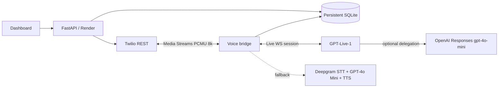

# Voice Foundry

**A local-first voice-agent command center.** Chat with an assistant to draft a call agenda, review/edit it, explicitly approve the call, run a Twilio + GPT-Live-1 or Deepgram + OpenAI voice conversation, and inspect its transcript and lifecycle.

 

**Start in demo mode without any provider credentials.** It does not dial anybody. Live outbound calling requires Twilio, OpenAI (plus Deepgram only for the fallback engine), a public HTTPS URL (provided automatically on Render; otherwise a local tunnel), an authorized destination, and `DEMO_MODE=false`.

## At a glance

| Capability | Included | Notes |
|---|---|---|
| Web UI | ✅ | Dark dashboard, call studio, agents, history, settings; no JS build step |
| Agenda from chat | ✅ | OpenAI when configured; deterministic template fallback |
| Editable agenda + explicit approval | ✅ | Never dials during plan generation |
| Local preview | ✅ | Text-based simulated call, optional OpenAI reply |
| Twilio outbound | ✅ Implemented | Real credentials and authorized recipient required; live network not exercised in this package |
| Twilio inbound | ✅ Implemented | Point incoming webhook at `/twilio/voice`; enable with env |
| GPT-Live-1 (new) | ✅ Adapter + offline tests | Direct bidirectional 8 kHz PCMU; separate Live API; needs real-provider smoke test |
| Dual selectable voice engines | ✅ | Choose GPT-Live or Deepgram per call, server default via `VOICE_ENGINE` |
| Deepgram STT / TTS | ✅ Implemented | Original Nova streaming STT + Aura TTS retained as fallback |
| Live transcripts and interruptions | ✅ Implemented | Twilio `clear`, streamed speech, transcript events |
| SQLite persistence | ✅ | Persisted in Docker volume by default |
| Controls | ✅ | API key, Twilio signatures, allowlist, per-plan approval, concurrency/rate/duration limits |
| Appointment booking integration | ❌ | No scheduling tools connected; never claim confirmed bookings |
| Native ChatGPT plugin | ❌ | Optional OpenAPI schema for Custom GPT Actions, not an installed native connector |
| Pipecat/Cerebrium | ❌ | This standalone adapter is local-first; see [Architecture](docs/ARCHITECTURE.md) |
| Recorded audio / agent voice customization | ❌ | Transcripts only; TTS model set via environment |

> **Scope:** This is a runnable *reference/MVP*, not an audited production telephony service. Live calls require validation with your accounts, end-to-end audio tests, consent/compliance review, monitored deployments, reliable distributed state, and secrets management. The default TTS is English only. Read [Risks and hardening](docs/SECURITY_AND_PRODUCTION.md).

## Deploy directly to Render (no ngrok or laptop server)

**Supported:** this repository includes a Render `render.yaml` Blueprint with a Docker web service, HTTPS/WSS callbacks, generated dashboard key, and a paid persistent disk for call history. Render runs the complete dashboard + real-time voice runtime.

1. Push this repository to a private GitHub repository.
2. In [Render](https://dashboard.render.com/), select **New > Blueprint**, choose the repository, and review the paid service/disk costs before applying.
3. Open the deployed HTTPS URL, locate the generated `APP_API_KEY` in the Render Environment settings, and log in. Initially, `DEMO_MODE=true` enables safe previewing.
4. Add Twilio and OpenAI credentials (Deepgram only for fallback), and allowlist your own test number. Switch `DEMO_MODE=false` when ready for live calls.
5. For inbound calls, configure Twilio's HTTP POST voice webhook to `https://YOUR-SERVICE.onrender.com/twilio/voice`. The code generates the `wss://.../twilio/media` stream URL.

You do **not** need ngrok, Docker Desktop, or an unrestricted laptop to deploy. See the detailed [Render deployment guide](docs/RENDER_DEPLOY.md). Render's Free plan does not provide persistent SQLite storage and sleeps during inactivity, so it is not appropriate for reliable phone calls.

## Prerequisites

- Docker Desktop (Windows with WSL2, macOS, or Linux with Docker Compose V2)
- Internet connection for pulling Python packages during first build
- Browser; recommended Chrome/Edge/Firefox
- For live calling: Twilio Programmable Voice number and Auth Token, an OpenAI API key, plus Deepgram key if using its engine; HTTPS hosting (Render already supplies this)

## Quick start on Windows (PowerShell)

```powershell
# From the extracted voice-foundry folder
Copy-Item .env.example .env
# Optional: change APP_API_KEY in .env now.
docker compose up --build -d
start http://localhost:8000
```

In the login screen, enter the `APP_API_KEY` value from `.env` (initial demo default: `dev-local-only-change-me`). Browse Call studio → enter a **test phone in E.164 format** and an agenda instruction → Create plan → edit → Approve & start preview. In demo mode no number is actually called.

**Other OS / one-script launch:**

```bash
cp .env.example .env
./scripts/run-local.sh
# open http://localhost:8000
```

On PowerShell you can alternatively run `./scripts/run-local.ps1`. Stop with `docker compose down`. Read logs using `docker compose logs -f voice-foundry`. Data is in a named Docker volume and survives normal restarts / `down` (but not `down -v`).

## Turn on real phone calling

1. Create / locate your credentials from [Twilio](https://console.twilio.com/) and [OpenAI](https://platform.openai.com/api-keys), or [Deepgram](https://console.deepgram.com/) when using the fallback. **Keep tokens in `.env`, never paste them into the web chat.**
2. Start the server: `docker compose up -d --build`.
3. Expose the server through TLS: `ngrok http 8000` (separate terminal). Copy the **HTTPS** forwarding domain, e.g. `https://abc123.ngrok-free.app`. The tunnel must forward WebSockets too.
4. Edit `.env`:

   ```dotenv
   APP_API_KEY=a-long-random-secret-generated-by-you
   DEMO_MODE=false
   PUBLIC_BASE_URL=https://abc123.ngrok-free.app
   TWILIO_ACCOUNT_SID=AC...
   TWILIO_AUTH_TOKEN=...
   TWILIO_PHONE_NUMBER=+1...
   OPENAI_API_KEY=...
   VOICE_ENGINE=openai_live
   OPENAI_LIVE_MODEL=gpt-live-1
   OPENAI_LIVE_VOICE=marin
   OPENAI_LIVE_BACKEND_MODEL=gpt-4o-mini
   # DEEPGRAM_API_KEY=...  # only for fallback
   OPENAI_MODEL=gpt-4o-mini
   ALLOWED_OUTBOUND_NUMBERS=+14155552671
   TWILIO_VALIDATE_SIGNATURES=true
   ```

5. Restart for new environment values: `docker compose up --build -d --force-recreate`.
6. Sign in with the **new** APP_API_KEY. Create plan for a number in the allowlist and click Approve & place live call.
7. To receive inbound calls, set Twilio number → **Voice: A call comes in** → Webhook / HTTP POST → `https://abc123.ngrok-free.app/twilio/voice`. Twilio opens a bidirectional stream at `wss://abc123.ngrok-free.app/twilio/media`, which is returned dynamically in TwiML.

**Twilio trial accounts** may dial only verified destinations; international and regional voice rules also apply. Your provider account must be authorized to use the destination. Check regulatory restrictions (including India) before outbound usage.

**Use real numbers only with authorization and appropriate consent.** Inform recipients that they're speaking to AI; get required consent for transcription and any recording (this implementation stores transcripts and does not record audio). Respect opt-outs, calling-hour rules, and applicable telecom/consumer-protection requirements.

## Example agent briefing

In Call studio set recipient `+14155552671`, agent `Ava`, and type:

> Introduce yourself as an AI receptionist for a dental clinic. Ask whether the patient wants a follow-up appointment. Collect their preferred day and time. Do not claim a booking occurred. Ask one question at a time and summarize the next step.

Press **Create plan**. The generated agenda is shown in the right inspector and can be edited before approval.

## What happens to the call?



**New in v0.2:** choose the runtime directly in Call studio. GPT-Live removes separate streaming STT and TTS stages, but requires OpenAI API billing and a real phone smoke test. The original engine remains available. See [GPT-Live upgrade and Render migration](docs/GPT_LIVE_UPGRADE.md).

## API overview

| Method | Endpoint | Purpose |
|---|---|---|
| `GET` | `/health` | Public process health |
| `GET` | `/api/config` | Safe non-secret status |
| `GET/POST` | `/api/agents` | Agent management |
| `GET/POST` | `/api/plans` | List and prepare plans |
| `PATCH` | `/api/plans/{plan_id}` | Edit uncalled plan |
| `GET/POST` | `/api/calls` | List and initiate approved calls |
| `GET` | `/api/calls/{call_id}` | Status + transcript |
| `POST` | `/api/calls/{call_id}/preview` | Simulated caller turn |
| `POST` | `/api/calls/{call_id}/hangup` | End call |
| `POST` | `/api/calls/{call_id}/summary` | Generate grounded call outcome report |
| `POST` | `/twilio/voice` | Twilio-signed TwiML callback |
| `POST` | `/twilio/status` | Twilio-signed call status |
| `WS` | `/twilio/media` | Twilio-signed bidirectional audio |

All `/api/*` paths require `X-API-Key: <APP_API_KEY>`. No secrets are returned by `/api/config`. FastAPI interactive API docs are at `http://localhost:8000/docs` (do not expose it on a public deployment without access control). See [API cookbook](docs/API.md).

## Run without Docker (Python 3.12)

```bash
python -m venv .venv
# Windows: .venv\Scripts\Activate.ps1
# macOS/Linux: source .venv/bin/activate
python -m pip install -r requirements-dev.txt
cp .env.example .env  # Windows PowerShell: Copy-Item .env.example .env
# Edit .env: DB_PATH=./data/voice_foundry.db (instead of Docker /data path)
python -m uvicorn app.main:app --host 127.0.0.1 --port 8000 --reload
```

### Tests

```bash
python -m pytest -q
python -m compileall -q app
```

Tests use demo mode and never call Twilio. The test harness has a minimal Twilio SDK shim *only if the real SDK isn't installed*, for disconnected CI/runtime testing. A real deployment must use the Twilio package from requirements.

## Repository map

```text
voice-foundry/
├── app/
│   ├── main.py              # FastAPI routes + Twilio control-plane callbacks
│   ├── voice.py             # Live full-duplex media pipeline
│   ├── db.py                # SQLite storage and transcripts
│   ├── planner.py           # Chat-based agenda generator + preview
│   ├── security.py          # API key + Twilio signature checks
│   ├── models.py            # Request validation
│   ├── prompts.py           # Call-specific AI instructions
│   └── config.py            # Validated env configuration
├── web/
│   ├── index.html           # Responsive dashboard
│   ├── styles.css           # Styling and animation
│   └── app.js               # Browser logic
├── integrations/chatgpt/    # GPT Action OpenAPI schema
├── docs/                   # Setup, design, API, security, operations
├── tests/                  # API, auth, planning, demo mode
├── scripts/                # Windows and Linux start helpers
├── .github/workflows/      # CI tests
├── .env.example
├── Dockerfile
├── docker-compose.yml
└── Makefile
```

## Documentation index

- [Deploy directly to Render without a tunnel](docs/RENDER_DEPLOY.md)
- [Detailed local setup](docs/LOCAL_SETUP.md)
- [Architecture and state transitions](docs/ARCHITECTURE.md)
- [REST API examples](docs/API.md)
- [Twilio, voice pipeline, and debugging](docs/VOICE_RUNTIME.md)
- [Security, privacy, limits, and production checklist](docs/SECURITY_AND_PRODUCTION.md)
- [Testing and acceptance criteria](docs/TESTING.md)
- [Connect with ChatGPT Custom GPT Actions](docs/CHATGPT_ACTIONS.md)

## A note on Pipecat and Cerebrium

The Cerebrium article demonstrates Pipecat in a managed compute environment. This repository instead implements **direct provider adapters** in Python to keep laptop setup lightweight, avoid CUDA/Torch downloads, and permit local Docker execution without GPU. It uses the same functional stages and Twilio's documented bidirectional WebSocket protocol. **Cerebrium deployment and Pipecat are not included**. They could be substituted as a future deployment/transport adapter, without changing the web control-plane contract.

## License

MIT, see `LICENSE`.

### Render planning API troubleshooting

If **Create Plan** displays `Unable to generate plan (HTTPStatusError)`,
this is an OpenAI API error, not a Render Blueprint error. See
[Render deployment troubleshooting](docs/RENDER_DEPLOY.md#dashboard-error-unable-to-generate-plan-httpstatuserror).
The updated code reports an actionable, sanitized status code without exposing credentials.
