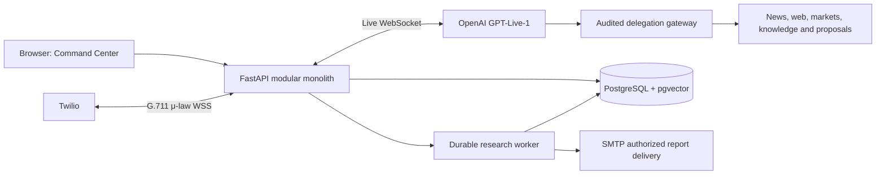

# Voice Foundry

**Build voice specialists. Give them an agenda. Keep conversations and actions under control.**

[](https://docs.github.com/en/actions) [](https://www.python.org/) [](LICENSE) 

Voice Foundry is a **single-server modular monolith** for personalized AI voice agents. Create news, Indian-market, appointment, and task agents. Assign contacts and permission scopes, draft and approve call agendas, converse using GPT-Live with Twilio, retrieve permitted memories or knowledge, and delegate research to a durable background worker that can email an opted-in recipient.

**Release status:** v4.0 alpha adds scoped temporal memory, voice-behaviour policies, and supervised improvement drafts. This is an externally unvalidated development build. It is **not** a promise that every product decision is production-complete. See the [capability matrix](docs/RELEASE_STATUS_FINAL.md) and [validation checklist](docs/VALIDATION_FINAL.md) before using real contact data or making live calls.

See [v4 intelligence design and owner APIs](docs/INTELLIGENCE_V4.md) and the [v4 release gates](docs/RELEASE_V4_CHECKLIST.md).

## First run

### Docker Compose (app + PostgreSQL + pgvector)

```bash
cp .env.example .env
# Edit .env to set strong APP_API_KEY, SESSION_SECRET and POSTGRES_PASSWORD.
docker compose up --build -d
docker compose logs -f voice-foundry
```

Windows PowerShell:

```powershell
Copy-Item .env.example .env
notepad .env
docker compose up --build -d
```

Open **http://localhost:8000**. With the default `DEMO_MODE=true`, no phone calls or external email are sent. Docker is required for the bundled PostgreSQL environment. If you cannot run Docker, use the Python-only instructions below; your restricted laptop can instead control the same application deployed on Render without a tunnel.

### Python-only development (SQLite)

```bash
python -m venv .venv
source .venv/bin/activate  # Windows: .venv\Scripts\Activate.ps1
python -m pip install -r requirements.txt -r requirements-dev.txt
cp .env.example .env
# Ensure DATABASE_URL is blank, and DB_PATH=./data/voice_foundry.db
python -m alembic upgrade head
python -m uvicorn app.main:app --reload --host 127.0.0.1 --port 8000
```

SQLite is for development and migration validation only. Use PostgreSQL + pgvector for the intended deployment.

## What is in the repository?

| Domain | Implemented module or feature |
|---|---|
| Voice | Twilio bidirectional Media Streams, 8 kHz μ-law, GPT-Live-1, interrupts, optional Deepgram fallback |
| Agent Studio | Four templates, draft/publish/rollback, version-pinned instructions, natural-language draft builder, supervised improvement proposals |
| Personality | Versioned bounded voice-policy controls, identity, playbooks, tone, interruptions, hard platform constraints |
| Contacts | Manual registration, CSV import, explicit phone/email consent flags, per-agent permission mapping |
| Memory | Consent-aware temporal consolidation, scoped retrieval/ranking, corrections, contradiction review, optional pgvector embeddings |
| Knowledge | PDF/DOCX/text upload, private/shared ACL, trust tiers, lexical or indexed pgvector search |
| Tools | News RSS, Brave Search, licensed NSE/BSE quote adapter, local calendar, task proposals |
| Live delegation | Backend-governed function calls for research/knowledge/task/appointment proposals |
| Workflows | Research job queue, leases, retries, schedules, pause/revise/cancel, SMTP reports after consent |
| Operations | Owner approval inbox, notifications, estimated budgets, call controls, structured outcomes |
| Integrations | Google owner sign-in, optional Google Contacts import and Calendar read |
| Infrastructure | FastAPI, SQLAlchemy, Alembic, Postgres, single-service Render/Docker deployment, pytest + CI |

Some features are deliberately bounded: Google Calendar writes are **not** yet synced; a matched caller number is not strong identity proof; human call transfer and full multi-step workflow graphs are not provided. Review the [explicit exclusions](docs/RELEASE_STATUS_FINAL.md).

## Architecture



One process handles the API and live WebSockets. Managed PostgreSQL is a stateful dependency, not a separate application microservice. Do **not** raise Render `numInstances` above 1 before distributed-worker and media-session architecture is implemented.

## Enable real phone calling

1. Use [Render deployment instructions](docs/DEPLOY_FINAL.md) for public HTTPS/WSS hosting without opening laptop ports.
2. Configure `OPENAI_API_KEY`, `TWILIO_ACCOUNT_SID`, `TWILIO_AUTH_TOKEN`, `TWILIO_PHONE_NUMBER`, public base URL and private owner login.
3. Register a consenting contact in the dashboard. Assign any required shared-agent permissions. Recording or retention notices must comply with applicable law.
4. Keep `DEMO_MODE=true` for simulated calls and sandbox exploration. When ready for one authorized test, set `DEMO_MODE=false`.
5. In Twilio, set the incoming voice webhook to `POST https://YOUR-RENDER-URL/twilio/voice`.
6. Prepare and approve an outbound call agenda, then make one short test call and review transcript/tool events.

OpenAI API billing is independent of your ChatGPT plan; a working paid API balance and GPT-Live access are required. The media path keeps μ-law audio at 8 kHz instead of introducing STT/TTS as separate network hops. Deepgram remains selectable as a comparison/fallback engine.

## Tools and specialist examples

- **Aria (news):** attributed Google News RSS and Brave web search; proactively suggests relevant context and optional background briefings.
- **Kuber (markets):** India-focused NSE/BSE quote adapter, market/news research. Delayed quotes are labeled; no trade execution or personalized financial advice.
- **Mira (appointments):** check local appointment availability, propose owner-approved booking; a proposal **does not** mean a booking exists.
- **Atlas (tasks):** track task-oriented objectives and propose external actions through explicit permission checks.

Agents have distinct published configurations; no cross-agent conversational collaboration is enabled. Public information may be shared through the knowledge library without sharing private caller memory.

## Privacy and authorization

- Dashboard actions require an owner session; Google OIDC uses the exact stable `GOOGLE_OWNER_SUB` for authorization.
- The Google Contacts/Calendar integration has separate opt-in OAuth scopes and encrypted tokens, requiring `INTEGRATION_ENCRYPTION_KEY`.
- Uploaded documents and tool results are **untrusted data**, never system instructions.
- Sensitive memories require explicit consent; passwords, OTPs, API keys and similar secrets must not be saved intentionally.
- Email research jobs require an active contact with recorded email consent; the worker re-checks consent immediately before delivery.
- Unknown phone callers must not obtain privileged personal data. OTP verification is not complete; do not enable privileged voice actions solely based on caller ID.

See [SECURITY.md](SECURITY.md) and [architecture](docs/ARCHITECTURE_FINAL.md).

## Tests and operations

```bash
python -m pytest -q
python -m compileall -q app scripts
node --check web/app.js
```

GitHub Actions includes a separate PostgreSQL + pgvector migration job. A working Docker Engine and provider credentials are needed for the independent live/staging checklist. The generated [OpenAPI schema](docs/openapi.json) documents authenticated endpoints.

## Documentation

- [Implementation status and known gaps](docs/RELEASE_STATUS_FINAL.md)
- [Architecture and trust boundaries](docs/ARCHITECTURE_FINAL.md)
- [Render/local deployment and rollback](docs/DEPLOY_FINAL.md)
- [Provider smoke test and QA gates](docs/VALIDATION_FINAL.md)
- [Original requirements and decisions](docs/DECISIONS.md)
- [Versioned prompt compiler](docs/PROMPT_FRAMEWORK.md)
- [Migrating existing SQLite data](docs/DATA_MIGRATION_V3.md)
- [Operator runbook](docs/OPERATIONS.md)
- [Contributing](CONTRIBUTING.md), [Security policy](SECURITY.md), [License](LICENSE)

## Contributing

This is an MIT-licensed reference implementation. Pull requests should include tests, documentation, security/privacy analysis for new tools, a reversible schema plan when applicable and evidence that existing Twilio call flows still work. Do not commit `.env` or live call transcripts.

Third-party provider logos, APIs, phone numbers, data feeds and model voices remain subject to their respective terms and subscription requirements.
