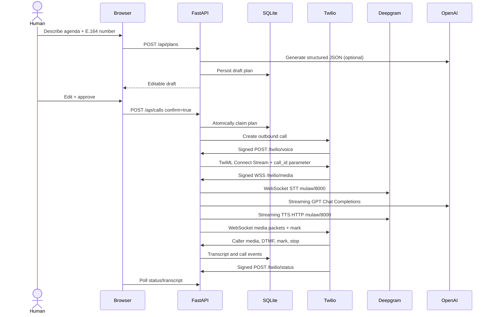

> **v0.2 GPT-Live update:** The original implementation remains available; see [GPT-Live Upgrade](GPT_LIVE_UPGRADE.md) for the new default engine, API differences, selection, Render migration and validation.

# System architecture & decisions

## Boundaries

**Control plane:** FastAPI routes under `/api`, browser dashboard, agenda planner, SQLite records.

**Telephony:** Twilio Programmable Voice REST + TwiML `<Connect><Stream>` (bidirectional). Twilio initiates the WebSocket server connection. An HTTP-signed callback returns stream TwiML. Outbound call creation is an explicit, operator-confirmed POST.

**Voice data plane:** One WebSocket session per telephone call, Deepgram streaming transcription, OpenAI text token streaming, and Deepgram streamed TTS. Twilio sends/receives raw μ-law at 8 kHz, which avoids codec transcoding. Audio is not written to disk.

## Sequence of an outbound call

## Database (SQLite)

- `agents`: display name, role, language, instruction prompt
- `plans`: recipient E.164, target agent, goal, agenda JSON, opening text, `draft|used`
- `calls`: Twilio SID, direction, mode `demo|live`, status, errors/timestamps
- `events`: ordered state / transcript / error / interruption records, speaker and timestamp

Call to plan is 1:0..1; a plan can be used at most once; a call has many events. UUID primary keys are created locally. SQLite WAL and busy timeout are enabled.

## Core invariants

1. Creating a plan never starts a telephone call.
2. `confirm=true` is mandatory and plan state switches atomically from `draft` to `used` to reject duplicate dials.
3. Live calls may target **only** numbers in the environment-defined allowlist.
4. Every Twilio HTTP callback and WebSocket handshake must present a valid Twilio signature in live mode.
5. The Twilio `CallSid` and unguessable `call_id` custom parameter must match the persisted record.
6. One live media stream binds to one persisted call; call length has a maximum.
7. No business action (appointment booking, charges, transfers) is performed by the LLM in this release.
8. Demo mode never invokes Twilio.

## Voice session concurrency

The voice WebSocket owns a Deepgram STT connection. The STT reader stays independent from the token/TTS task so barge-in can cancel playback. Twilio's `clear` command flushes already buffered audio. Media writes are serialized using `asyncio.Lock`. A mark is sent following each completed assistant utterance. Cancellation increments a session generation counter to prevent old audio from being sent after an interruption.

**Limitations:** The transcript is a completed-utterance ledger, not a word-accurate record of what was actually audibly played when interrupted. One async worker handles concurrent calls in one process; session state is in memory. Multi-node deployments need durable queues, distributed call locks, worker-to-call affinity, and a more robust event bus. Also add explicit post-call analysis workers, recording-consent mechanisms, retries/circuit-breakers, business tool gateway, and benchmarks.

## Why direct adapters rather than Pipecat?

This version runs on a small laptop using standard Python and httpx/websockets. It deliberately doesn't bundle Pipecat/Torch/Silero or Cerebrium-specific configuration. The modules are separable: `main.py` holds call/control APIs, `voice.py` holds transport and provider behavior, `planner.py` holds LLM-generated agenda. A subsequent adapter can swap `VoiceSession` for a Pipecat pipeline without changing frontend contract. This is a conscious implementation difference from the linked Cerebrium tutorial.
