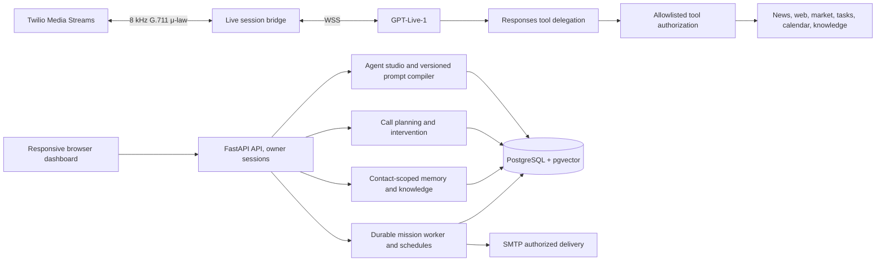

# Voice Foundry: Final v3 architecture

## Logical system topology

One web service owns all Python modules in one process. PostgreSQL is a separate stateful service. **Do not scale the web service to multiple instances** without extracting WebSocket routing, acquiring robust distributed worker ownership, and reconciling shared session state.

## Trust and data flow

1. Twilio signs HTTP webhooks; the media stream verifies the expected call ID, Call SID and signature/origin controls before voice processing.
2. A call receives a pinned published agent-release ID. The prompt compiler combines platform rules, role, tone, language, agenda, routine memory and explicit per-agent tool permissions.
3. Live model speech is not authorized to call arbitrary URLs, access a database directly, or mint its own approvals. All actual tool calls run in the backend. Published tool grants are rechecked during active calls to support emergency revocations.
4. Caller memory is isolated by `(agent_id, contact_id)`. Knowledge is either shared or assigned to a specific agent; quarantined sources cannot be retrieved. A phone number is only a recognition hint, not privileged authentication.
5. Risk-bearing actions become owner-reviewed approval proposals. Local appointments require an approval record whose exact arguments match the booking request. No external action is reported successful until provider acknowledgement.
6. Research workers claim Postgres jobs and record checkpoints. Research source data, transcripts and uploaded documents are untrusted and cannot override tool policy or system rules. The email layer rechecks recipient consent before sending.
7. Demo mode never places calls or sends emails. Voice Lab uses short-lived signed tokens and never stores production call history.

## Prompt compiler anatomy

* Platform-level invariants: AI identity disclosure, consent, non-impersonation, privacy boundaries, untrusted input handling and verified action reporting.
* Agent identity: domain expertise, predictable personality, language and published voice.
* Conversation policy: proactive but bounded, interruption-aware, concise with appropriate backchannels, one question at a time when appropriate.
* Call agenda: goals, required facts and approval checkpoints.
* Authorized context: relevant routine caller memories and source-backed knowledge.
* Runtime model session: GPT-Live audio format and optional audited Responses function-calling catalog.

LLM instructions **help** behaviour, but must never be relied upon as the only enforcement layer for access, spending, consent or tool safety.

## Data model

- `agents`, `agent_releases`, `plans`, `calls`, `events`
- `contacts`, `agent_contact_permissions`, `memories`, `memory_events`, optional `memory_vectors`
- `knowledge_sources`, `knowledge_chunks`, optional `knowledge_vectors`
- `missions`, `mission_events`, `worker_steps`, `mission_schedules`, `schedule_occurrences`
- `approvals`, `audit_events`, `expenses`, `notifications`, `runtime_controls`
- `calendar_events`, `outcome_reports`, `agent_feedback`, `integrations`, `mail_deliveries`

Privacy and retention are partly enforced through existing routine memory policy and transcript purge. Production retention across backups and providers requires additional compliance engineering.

## Scale path

1. This candidate: one server instance + managed PostgreSQL.
2. Stabilization: move mission scheduler and post-call extraction into a separate worker; add shared external rate limiting and durable voice session state.
3. Scale: distributed queue with leases, WebSocket sticky ownership, message bus, application replicas behind a gateway and optional Docker Swarm/Kubernetes.
4. Future: dedicated media edge and specialized inference gateway after measuring actual bottlenecks.
