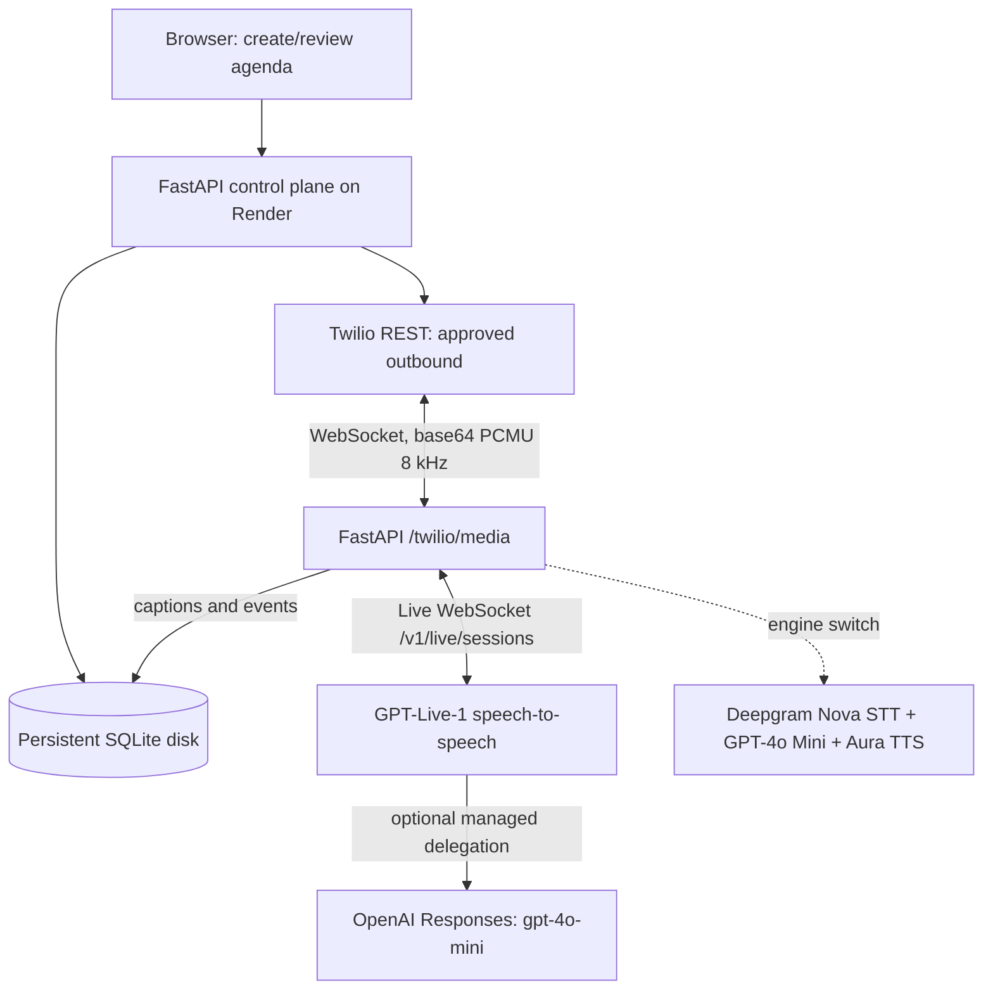

# GPT-Live-1 Engine: Upgrade & Implementation

Voice Foundry v0.2 adds **GPT-Live-1** as an alternative to the original Deepgram pipeline, on **the same existing FastAPI/Twilio/Render app**. No Cerebrium, ngrok, or additional public service is necessary on Render.

> **Status:** Protocol adapter and offline simulations implemented and tested. A live Twilio/GPT-Live call and the supported backend-delegation model still require validation using your OpenAI project. This is not a provider-certified deployment.

## System architecture



The web UI's voice-engine dropdown is saved **per call** in the `calls.voice_engine` column. The deployment-level `VOICE_ENGINE` is merely the default. This makes a controlled A/B test possible with the same Twilio number and unchanged agendas.

## New environment keys

```dotenv
VOICE_ENGINE=openai_live
OPENAI_LIVE_MODEL=gpt-live-1
OPENAI_LIVE_VOICE=marin
OPENAI_LIVE_BACKEND_MODEL=gpt-4o-mini
LIVE_BARGE_IN_RMS=900
LIVE_BARGE_IN_FRAMES=5

# Still required for live calls
DEMO_MODE=false
OPENAI_API_KEY=...          # Active API billing and GPT-Live access
TWILIO_ACCOUNT_SID=AC...
TWILIO_AUTH_TOKEN=...
TWILIO_PHONE_NUMBER=+...
ALLOWED_OUTBOUND_NUMBERS=+...
```

`DEEPGRAM_API_KEY` is required **only** for calls explicitly using the `deepgram` engine. GPT-Live-1 does not require Deepgram. A working `OPENAI_MODEL=gpt-4o-mini` remains required for the original engine, plan generation, demo responses and call summaries. Planning and summaries can use this model without using GPT-Live.

## Live transport details

1. Twilio sends an authenticated `/twilio/voice` HTTP POST. The response contains `<Connect><Stream>` with a call identifier.
2. Twilio opens the bidirectional `/twilio/media` WebSocket and sends `connected`, then `start`.
3. The backend verifies the Twilio signature, matching CallSid and stored call ID; it reads the engine selected for that call.
4. For `openai_live`, `app/live_voice.py` opens `wss://api.openai.com/v1/live/sessions` using the server API key.
5. It sends **`session.start` first**, with `model`, a voice, 8 kHz PCMU format, call agenda, and a developer startup greeting message.
6. It waits for `session.started`; only then forwards Twilio `media.payload` bytes as `session.input_audio.append` events.
7. GPT-Live returns `session.output_audio.delta` chunks. Audio bytes are relayed as Twilio `media` and `mark` messages, without converting codecs.
8. Transcript deltas are appended to the call timeline. These are imperfect caption fragments, **not guaranteed word-perfect transcripts or turn boundaries**.
9. On hangup, the app attempts `session.close` and waits up to five seconds for `session.closed` and final usage; abrupt network failures may prevent confirmation.

Do **not** replace the Live URL with `wss://api.openai.com/v1/realtime?model=...`. Realtime and GPT-Live have different startup events, audio event names and session lifecycle semantics.

### Delegated backend reasoning

When the voice model wants reasoning help, `delegation.type=responses` asks the Live service to invoke a backend Responses model, configured via `OPENAI_LIVE_BACKEND_MODEL`. The default is the inexpensive `gpt-4o-mini`. This is **only reasoning**, not a CRM or appointment-booking tool: `tool_choice` is `none` and the assistant must not claim it performed an external action. Backend model calls are billed in addition to GPT-Live minutes. If your OpenAI project rejects the selected Responses backend model, use a model your project supports and retry; check the session-start error in Render logs.

## Interruption and latency mechanics

- **GPT-Live** can understand simultaneous listening and speech. A separate STT and TTS call is removed from the critical path.
- **Twilio** independently buffers audio you already sent. Server-side model interruption does not retroactively remove it. The bridge therefore sends 40 ms or smaller PCMU packets with playback `mark`s.
- While Twilio still has playback marks outstanding, a lightweight local μ-law energy gate clears buffered audio after sustained caller speech. This is an **energy heuristic**, not a trained noise/echo-cancelled VAD. The default RMS threshold is 900, five 20 ms frames. Echo and background sound can trigger false clears; if observed, increase `LIVE_BARGE_IN_RMS` (e.g. 1400), increase `LIVE_BARGE_IN_FRAMES` (e.g. 8), or disable this local detector with `LIVE_BARGE_IN_RMS=0` and rely on GPT-Live conversational interruption.
- The bridge paces output audio at its encoded sample rate, so generated output is not dumped into a large Twilio playback buffer all at once. This lowers the interruption backlog but may increase outgoing response delay on heavily loaded instances.
- With a paid Render instance, no spin-up should be required. CPU saturation, provider network distance, Twilio region, network jitter and backend delegation can still affect latency.

## Rollout on an EXISTING Render service

1. Back up the persistent SQLite volume if it contains important conversations (Render disk snapshot or controlled export). **Do not delete or replace the existing persistent disk.**
2. Commit the changed files on your existing GitHub repository, preserving the same repository and Render service.
3. Redeploy the existing Render service (Dashboard > Manual Deploy > Deploy latest commit). Alternatively, if the service was created from a Blueprint, sync the Blueprint after reviewing any config changes.
4. In Render Environment, confirm `VOICE_ENGINE=openai_live`, `OPENAI_LIVE_MODEL=gpt-live-1`, `OPENAI_LIVE_VOICE=marin` and `OPENAI_LIVE_BACKEND_MODEL=gpt-4o-mini`.
5. Keep `PUBLIC_BASE_URL` as the **same working Render HTTPS domain**, `TWILIO_VALIDATE_SIGNATURES=true`, and the existing Twilio webhook pointed at `/twilio/voice`. Do not add ngrok.
6. Set `DEMO_MODE=true` initially. Test creating a plan and selecting each engine; neither selection should dial a phone in demo mode. Then set `DEMO_MODE=false` with working provider keys and an allowlisted test number.
7. Start with a short authorized call (30–60 sec). Compare first audible response, interruptions and transcript quality. Watch Render Logs and API usage.
8. If GPT-Live fails in production, select **Deepgram** in the call studio for the next call. Calls already in progress do not switch engine midstream.

On startup, `app/db.py` migrates your existing `calls` table by adding the `voice_engine` column with default `deepgram`. Existing calls and history remain in place, including existing UI data and previously saved plans.

## Credentials and billing

The Live model uses an OpenAI **API** project, not a ChatGPT subscription. Verify model eligibility, adequate API credit, and concurrent-session limits. Live voice sessions are billed by elapsed duration. Twilio telephone usage, hosted compute, and delegated OpenAI Responses calls are separate charges. Deepgram is billed only if that engine is selected.

## Limitations and validation checklist

- Real provider API calls were not exercised in the offline build environment. Session start and backend model compatibility require a real smoke test.
- No function calling, appointment booking, calendar access, CRM mutation, transfer, recording, or guaranteed compliant disclosure recording is implemented.
- Transcription/caption text is approximate and may contain fragmented utterances. The app stores text, **not raw audio**.
- Twilio call/SID validation, key authentication, allowlisting, max duration and prior approval remain enforced.
- Render restart or failed deployment can terminate in-progress calls; test operational recovery before business use.

## Troubleshooting

| Symptom | What to check |
|---|---|
| `OpenAI API HTTP 429` when creating plans | `OPENAI_API_KEY` credits/limits for the **text** model, separate from Live. |
| `session.start` rejected | Valid `OPENAI_LIVE_MODEL=gpt-live-1`, backend Responses model access, API project billing. Check Render logs; never expose keys. |
| No audio after connection | Twilio `streamSid` and CallSid mapping; `session.started` event; PCMU 8 kHz. |
| Hearing old responses during interruption | Set lower VAD frames or raise RMS carefully; check Twilio `mark` / `clear` events. |
| Assistant gets cut off by echoes | Increase `LIVE_BARGE_IN_RMS` and frames; disable with `0` to isolate cause. |
| Caption gaps or fragmented text | Live deltas are approximate and have no full-turn marker; this MVP flushes caption buffers on call end or size threshold. |
| Using Deepgram engine fails | `DEEPGRAM_API_KEY`, STT/TTS model, and OpenAI text key must be present. |
| 429 during a GPT-Live call | Check model-specific concurrent session access and available API credits. |

## Primary references

- [OpenAI GPT-Live WebSockets](https://developers.openai.com/api/docs/guides/voice-websockets)
- [OpenAI GPT-Live Sessions](https://developers.openai.com/api/docs/guides/live-conversations)
- [OpenAI GPT-Live Delegation](https://developers.openai.com/api/docs/guides/live-delegation)
- [Twilio Bidirectional Media Streams](https://www.twilio.com/docs/voice/media-streams/websocket-messages)
